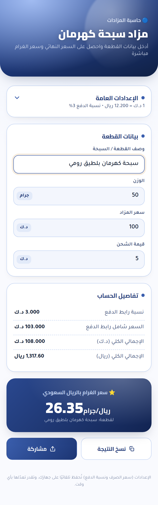
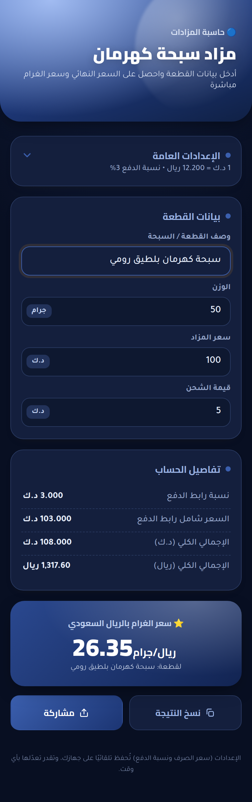

# مزاد سبحة كهرمان — تطبيق أندرويد

حاسبة مزادات للسبح: تدخل سعر المزاد بالدينار الكويتي، ونسبة رابط الدفع، وقيمة الشحن،
والوزن بالجرام — ويطلع لك الإجمالي بالريال السعودي **وسعر الغرام** مباشرة.

<p align="center">
  
  
</p>

## التثبيت على الجوال

1. نزّل ملف `.apk` على جوالك.
2. افتحه من تطبيق «الملفات» أو من إشعار التنزيل.
3. أندرويد راح يطلب تفعيل **«السماح بتثبيت التطبيقات من هذا المصدر»** — فعّلها
   للتطبيق اللي تفتح منه الملف (المتصفح أو مدير الملفات)، ثم ارجع واضغط «تثبيت».

> التطبيق موقّع بمفتاح تطوير لأنه للتثبيت الشخصي المباشر وليس عبر Google Play.

## المميزات

- **يشتغل بالكامل بدون إنترنت** — لا يوجد إذن `INTERNET` في التطبيق أصلًا.
  الصفحة والخطوط والحسابات كلها مدمجة داخل الـ APK.
- **حفظ الإعدادات** — سعر الصرف ونسبة رابط الدفع تُحفظ تلقائيًا على الجهاز.
- **نسخ ومشاركة النتيجة** — ملخّص عربي منسّق يُشارك عبر واتساب أو أي تطبيق آخر.
- **وضع ليلي** يتبع إعداد النظام.
- **خطوط Cairo و Tajawal مدمجة** (مقطعا arabic و latin فقط، ‎140 KB إجمالًا).

## المعادلات

```
العمولة            = سعر المزاد × نسبة رابط الدفع
السعر شامل الرابط  = سعر المزاد + العمولة
الإجمالي (د.ك)     = السعر شامل الرابط + الشحن
الإجمالي (ريال)    = الإجمالي بالدينار × سعر الصرف
سعر الغرام         = الإجمالي بالريال ÷ الوزن
```

القيم الافتراضية: سعر الصرف `12.20` ريال للدينار، ونسبة رابط الدفع `3%`.

## البناء من المصدر

يحتاج JDK 17 فأعلى و Android SDK (platform 35 و build-tools 35.0.0).

```bash
echo "sdk.dir=$ANDROID_HOME" > local.properties
./gradlew assembleRelease
# الناتج: app/build/outputs/apk/release/app-release.apk
```

### مفتاح إصدار حقيقي (اختياري)

بدون إعداد، تُوقَّع نسخة الإصدار بمفتاح التطوير حتى تبقى قابلة للتثبيت. لو تبغى
مفتاحك الخاص (مطلوب لـ Google Play)، أنشئ `keystore.properties` في جذر المشروع:

```properties
storeFile=my-release-key.jks
storePassword=...
keyAlias=...
keyPassword=...
```

الملف ومفاتيح `*.jks` مستثناة في `.gitignore`.

## بنية المشروع

| المسار | الوصف |
|---|---|
| `app/src/main/assets/index.html` | واجهة الحاسبة كاملة (HTML/CSS/JS) |
| `app/src/main/assets/fonts.css` | مولّد آليًا — لا تعدّله يدويًا |
| `app/src/main/java/.../MainActivity.kt` | يعرض الصفحة داخل WebView |
| `app/src/main/java/.../WebAppBridge.kt` | جسر النسخ والمشاركة مع أندرويد |
| `tools/fetch-fonts.sh` | ينزّل الخطوط ويولّد `fonts.css` |
| `tools/render-icons.sh` | يولّد أيقونات PNG لأجهزة API 24-25 |
| `tools/verify-page.js` | فحوصات الحسابات والتخزين والخطوط + لقطات الشاشة |

### ملاحظة معمارية

الصفحة تُقدَّم عبر `WebViewAssetLoader` على الأصل
`https://appassets.androidplatform.net/` وليس عبر `file://`، لأن أصول `file://`
تُعامل في WebView الحديث كأصول مبهمة (opaque) فلا يعمل عليها `localStorage` —
وهو ما تعتمد عليه الصفحة في حفظ الإعدادات.

## التطوير

بعد أي تعديل على `index.html`:

```bash
node tools/verify-page.js   # يشغّل الفحوصات ويحدّث اللقطات
./gradlew assembleRelease
```
